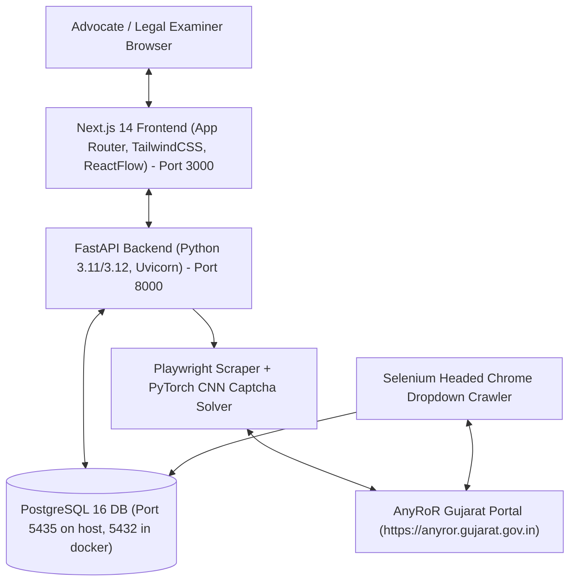

# TitleNode (AnyRoR Gujarat SaaS) - System Context, Architecture & Workflow Master Guide

> **Important**: This document preserves the entire operational context, legal revenue logic, software architecture, and execution runbook for **TitleNode**. When starting a new AI session or switching machines, reading this file brings the agent to 100% full context.

---

## 1. Executive Summary & Project Mission

**TitleNode** is a B2B SaaS platform specifically engineered for property advocates, real estate legal teams, and bank panel advocates across Gujarat. It transforms unstructured, raw, and often chaotic land records from the Gujarat Government portal (**AnyRoR** - `anyror.gujarat.gov.in`) into:

1. **Pedhinamu Family Trees (પેઢીનામું)**: Visual family lineage graphs linking ancestral land ownership across multiple generations.
2. **Mutation Flow Timelines (ગામ નમૂના નં. ૬)**: An unbroken chain of title tracking every transaction from 1951 to the present.
3. **Statutory Title Audits & Risk Traffic Lights**: Automated compliance verification for the Hindu Succession Act (Daughters' Rights), Gujarat Tenancy & Agricultural Lands Act (Tenure restrictions), and Bank Encumbrances.
4. **Verified 30-Year Land Dossier Reports**: Print-ready, bank-compliant legal title clearance certificates with Cadastral Boundary Maps (નકશો) and Re-Survey Promulgation bridges.

---

## 2. Full Architecture & Tech Stack



### Stack Components:
- **Frontend**: Next.js 14 App Router, TypeScript, TailwindCSS, ReactFlow (`reactflow`) with custom nodes and controls. TitleNode bespoke luxury theme: Navy (`#0F2C59`), Warm Gold/Sand (`#DAC0A3`), Cream (`#F8F0E5`).
- **Backend**: FastAPI, SQLAlchemy 2.0 (asyncpg), Pydantic v2, Uvicorn.
- **Database**: PostgreSQL 16 Alpine. Default container name `anyror_db_fresh`. Port mapped to `5435` on Windows host to avoid conflicts with default Postgres port 5432.
- **Scraping Engine**:
  - Playwright (`backend/app/scraper/client.py`) for live survey search & CAPTCHA solving.
  - Selenium Headed Chrome (`backend/scripts/crawl_dropdowns_headed.py`) for live 4-dropdown administrative hierarchy crawling.
- **AI / Computer Vision**:
  - PyTorch CNN (`backend/captcha/captcha_model_v1.pth`) for instant offline solving of AnyRoR numeric CAPTCHAs.
  - Google GenAI SDK (`google-genai`) with free-tier Gemini models (`gemini-2.5-flash`, `gemini-2.0-flash`, `gemini-1.5-flash`, `gemini-3.8-flash`) + Archival Historical Deed Catalog fallback.

---

## 3. Database Schema Overview

The database contains tables defined in `backend/app/db/models.py`:

1. `land_records`:
   - `survey_no`: Search query survey number (e.g., "2", "28").
   - `district_code`, `taluka_code`, `village_code`.
   - `extracted_data`: JSONB storing raw 7/12 details, Promulgation details, Old Survey number, Tenure, Area, Assessment, Cadastral Map paths, and Risk Flags.
2. `mutation_entries`:
   - `land_record_id`: Foreign key to `land_records`.
   - `entry_number`: Revenue mutation note number (e.g., "633", "1107").
   - `image_file_path`: Path to scanned historical deed `.jpg` (if pre-digitization).
   - `scraped_html_text`: Raw AnyRoR 4-column table text.
   - `ai_draft_data`: Extracted JSON facts (previous owners, new owners, transaction type, dates, remarks).
   - `final_verified_data`: Advocate-verified data after review.
   - `is_verified`: Boolean flag (Human-in-the-Loop completion).
3. `district_index`:
   - `district_code` (e.g. "01", "07"), `district_name` (e.g. "Kachchh", "Ahmedabad").
4. `taluka_index`:
   - `district_code`, `taluka_code`, `taluka_name`.
5. `village_survey_index`:
   - `district_code`, `taluka_code`, `village_code`, `village_name`, `survey_numbers` (array of survey numbers), `total_surveys`.

---

## 4. The 6 Core Workflows (In-Depth)

### Workflow 1: Live AnyRoR Scraper & Captcha Solver
- **Code**: `backend/app/scraper/client.py`, `backend/app/scraper/parser.py`.
- **Target**: `https://anyror.gujarat.gov.in/LandRecordRural.aspx`.
- **Execution**:
  1. Opens AnyRoR Rural Land Records.
  2. Selects record type (Option 8: Integrated Survey Details).
  3. Fills cascading dropdowns: District -> Taluka -> Village -> Survey Number.
  4. Downloads numeric CAPTCHA image and passes it to `backend/captcha/captcha_model_v1.pth` (PyTorch CNN), solving it in ~10ms with 99%+ accuracy.
  5. Submits form; parses returned ASP.NET table (`grdcmputerentry`) into clean Gujarati text.
  6. Downloads high-res scanned deed images (`mutation_entry_*.jpg`) and Cadastral Map boundary polygon (`cadastral_map_*.png`).

### Workflow 2: Administrative Hierarchy & Dropdown Scraper
- **Code**: `backend/scripts/crawl_dropdowns_headed.py`, `crawl_dropdowns.bat`.
- **Target**: `https://anyror.gujarat.gov.in/LandRecordRural.aspx`.
- **Purpose**: Crawls every District -> Taluka -> Village -> Survey Number across Gujarat and stores them in PostgreSQL for frontend instant search and autocomplete.
- **Anti-Ban Architecture**:
  - Uses a **Headed Chrome Window** (`--headed`) so AnyRoR's firewall and Cloudflare do not trigger headless bot blocks.
  - Random human jitter delays (1.2s to 2.8s) between dropdown selections.
  - Checkpoint / Resume logic: if restarted, it checks existing DB entries and skips already crawled villages.
  - Supports Scope Selection: Single District, Custom District, Fast Mode (skip surveys), or All 34 Districts.

### Workflow 3: The 10 Gujarat Revenue Rules Engine & Genealogical Graph
- **Code**: `backend/app/services/genealogy_service.py`.
- **The 10 Rules**:
  1. **Rule 1 (Multi-Survey Boundary Quarantine)**: Quarantines massive cooperative bank entries (50–500 farmers) so outside villagers don't pollute the target family tree.
  2. **Rule 2 (Re-Survey Promulgation Bridge)**: Reconstructs pre-2014 title by linking Old Survey numbers (e.g. Old 80 / Old 113) to New Survey numbers (New 2 / New 28) via Promulgation Entry #633.
  3. **Rule 3 (Hierarchical Kinship Classifier)**: Evaluates Widows (`ગં.સ્વ.`, `વિધવા`) **before** daughters; separates Minors, Guardians (`વાલી`), and Powers of Attorney (`મુખત્યાર`).
  4. **Rule 4 (Phonetic & Canonical Normalizer)**: Harmonizes Gujarati spelling variations (`ૂ/ુ, ી/િ, ઈ/ઇ, ભાઈ/ભાઇ`) so duplicate nodes aren't created for the same person.
  5. **Rule 5 (Fractional Tenure & Area Accounting)**: Differentiates between partial undivided share sales and complete ownership exits.
  6. **Rule 6 (Daughter Rights & HSA 2005 Audit)**: Scans Circle Officer remarks for Hak Kami affidavits (`હક કમી સોગંદનામું`), categorizing daughters into Cleared, Active Co-owner, or Omitted Risk.
  7. **Rule 7 (Bank Loan Lifecycle Reconciler)**: Reconciles mortgages (`બોજો દાખલ`) with releases (`બોજા મુક્તિ`) to prevent false active loan warnings.
  8. **Rule 8 (Statutory Land Tenure Restrictions)**: Audits Old Tenure (જુની શરત) vs New Tenure (નવી શરત), Section 43/63 permissions, and premium requirements.
  9. **Rule 9 (Dispute & Certification Filter)**: Flags rejected (`નામંજૂર`), cancelled (`રદબાતલ`), or civil court stayed (`તકરારી`) mutations.
  10. **Rule 10 (Archival Handwritten VF-6 Harmonizer)**: Links pre-digitization scanned register deeds with uncropped page viewing.

### Workflow 4: Advocate Human-in-the-Loop Review
- **Code**: `frontend/src/app/advocate/review/[survey_id]/page.tsx`, `backend/app/api/v1/endpoints/mutations.py`.
- **UI Architecture**:
  - Split-screen workspace: Left pane displays high-res uncropped deed scan (with smooth pan/zoom) or authentic 4-column AnyRoR government table. Right pane displays extracted fields.
  - Automated extraction runs in background upon load (Gemini free tier + Archival Deed catalog fallback); no manual button clicks required.
  - "Approve & Commit to Ledger" persists verification to database and advances to the next mutation.

### Workflow 5: Pedhinamu Family Tree & Audit Workspace
- **Code**: `frontend/src/app/advocate/tree/[survey_id]/page.tsx`.
- **Features**:
  - **Metric Bar**: Live counters for Total Persons, In Property, Exited, Daughters, Active Loans, Land Tenure, and Old Survey badge (`🏛️ જૂનો સરવે: ૮૦ (નોંધ #૬૩૩)`).
  - **Tab 1 (Pedhinamu Tree)**: Full interactive ReactFlow multi-branching tree with person search and filter pills.
  - **Tab 2 (Mutation Flow)**: Chronological mutation chain with contextual badges (Promulgation Bridge, Sale, Hak Kami, Historical Scan).
  - **Tab 3 (Audit Workspace)**: Dedicated cards for Daughter Rights, Statutory Tenure Restrictions, Promulgation 30-Year Continuity Bridge, and Encumbrance Lifecycle.

### Workflow 6: 30-Year Verified Land Dossier
- **Code**: `frontend/src/app/advocate/dossier/[survey_id]/page.tsx`.
- **Sections**:
  - Section 1: Core Risk Assessment (traffic lights for Ownership, Tenure, Encumbrance, Litigation).
  - Section 2: Promulgation & Re-Survey Continuity Bridge (old survey, promulgation date/note, area, assessment, historical mutations, historical encumbrances, cadastral boundary map).
  - Section 3: Verified Chain of Title (chronological narrative).
  - Section 4: Verified Lineage Graph (ReactFlow interactive on screen, clean vertical chart on PDF print).
  - Section 5: Advocate Signature & Certification block.

---

## 5. New Laptop Setup Instructions

Follow these exact steps when cloning this repo on a new laptop:

### Step 1: Clone Repository
```bash
git clone https://github.com/Hardikp2510/anyror_2.git
cd anyror_2
```

### Step 2: Ensure Prerequisites are Installed
1. **Docker Desktop**: Install from [docker.com](https://www.docker.com/products/docker-desktop/) and start it.
2. **Python 3.11 or 3.12**: Install from [python.org](https://www.python.org/downloads/) (Check "Add Python to PATH").
3. **Google Chrome**: Needed for the headed dropdown crawler.
4. **Git**: Installed.

### Step 3: Launch TitleNode with 1-Click
Double-click `START_PROJECT.bat` in the project root, or open terminal and run:
```cmd
START_PROJECT.bat
```
This script will:
- Check / Start Docker Desktop automatically.
- Spin up PostgreSQL 16, FastAPI backend, and Next.js frontend in containers.
- Automatically verify health endpoints.
- Open your browser directly to `http://localhost:3000/advocate`.

---

## 6. How to Run the Live Dropdown Scraper on the New Laptop

To crawl live Gujarat administrative hierarchy (Districts -> Talukas -> Villages -> Survey Numbers):

1. Ensure the database is running (running `START_PROJECT.bat` starts the DB, or run `docker compose up -d db`).
2. Double-click `crawl_dropdowns.bat` or run:
   ```cmd
   crawl_dropdowns.bat
   ```
3. The script will automatically verify and install `selenium` and `psycopg2-binary` if needed.
4. Choose your crawl scope:
   - `1`: Crawl Kutch District (01)
   - `2`: Crawl Ahmedabad District (07)
   - `3`: Crawl a Custom District Code (e.g. 02, 14, 22)
   - `4`: Crawl ALL 34 Gujarat Districts
   - `5`: Fast Mode (Crawl all districts, talukas, and villages without waiting for individual survey numbers)
5. A visible Chrome browser will open and automatically navigate through AnyRoR dropdowns safely with human jitter delays. All records are saved directly to PostgreSQL (`district_index`, `taluka_index`, `village_survey_index`).

---

## 7. Master Prompt for a New Antigravity AI Session

Copy and paste the prompt below into Antigravity when opening this repository on your new laptop:

```markdown
Hello Antigravity. I have cloned my repository on a new laptop. 

Before giving any answers or proposing code changes, I need you to understand this entire project in complete depth. 

Please perform the following steps immediately:
1. Read the comprehensive architecture file: `SYSTEM_CONTEXT_AND_WORKFLOW.md`.
2. Review the 10 Gujarat revenue rules in `WORST_CASE_REVENUE_RULES.md`.
3. Inspect `backend/app/services/genealogy_service.py` to understand the Promulgation Bridge, daughter rights auditor, and family tree graph generation.
4. Inspect `backend/scripts/crawl_dropdowns_headed.py` and `crawl_dropdowns.bat` to understand the live AnyRoR 4-dropdown scraper.
5. Inspect `frontend/src/app/advocate/review/[survey_id]/page.tsx`, `frontend/src/app/advocate/tree/[survey_id]/page.tsx`, and `frontend/src/app/advocate/dossier/[survey_id]/page.tsx`.

Once you have absorbed all context, confirm you understand:
- The 6 core workflows of TitleNode.
- The 10 revenue rules for Gujarat land records.
- How the database, backend, and frontend interact.
- How the live dropdown hierarchy crawler works and how to execute it.

Then, wait for my instruction.
```
